# Entity-Relationship (ER) Diagram
## Employee Retention Support System (Phase 1 Database Architecture)

The system consists of **14 Core Domain Entities** and **4 Supporting Entities** designed with strict temporal separation, effective-dating, and historical preservation.

```mermaid
erDiagram
    COMPENSATION_BAND ||--o{ ROLE : "tiers"
    ROLE ||--o{ EMPLOYEE : "designates"
    TEAM ||--o{ EMPLOYEE : "employs"
    EMPLOYEE ||--o{ EMPLOYEE : "manages"
    
    EMPLOYEE ||--o{ TEAM_MEMBERSHIP_HISTORY : "retains history"
    TEAM ||--o{ TEAM_MEMBERSHIP_HISTORY : "tracks transfers"
    ROLE ||--o{ TEAM_MEMBERSHIP_HISTORY : "tracks role in team"
    
    EMPLOYEE ||--o{ TENURE_SNAPSHOT : "accrues quarterly"
    ROLE ||--o{ TENURE_SNAPSHOT : "captures role at snapshot"
    TEAM ||--o{ TENURE_SNAPSHOT : "captures team at snapshot"
    
    EMPLOYEE ||--o{ WORKLOAD_SNAPSHOT : "logs quarterly strain"
    EMPLOYEE ||--o{ ENGAGEMENT_SURVEY : "submits voluntary pulse"
    EMPLOYEE ||--o{ PROMOTION_HISTORY : "achieves"
    
    EMPLOYEE ||--o| ATTRITION_OUTCOME : "post-horizon ground truth (1:1)"
    
    EMPLOYEE ||--o{ INTERVENTION : "receives supportive touchpoint"
    EMPLOYEE ||--o{ INTERVENTION : "conducts (as manager/HR)"
    INTERVENTION ||--o{ INTERVENTION_EVENT : "logs event trail"
    
    APP_USER |o--o| EMPLOYEE : "optional account link"
    
    ANALYSIS_RUN ||--o{ SUPPORT_ASSESSMENT : "generates explainable scores"
    EMPLOYEE ||--o{ SUPPORT_ASSESSMENT : "assessed"
    
    VALIDATION_RUN ||--o{ VALIDATION_ISSUE : "detects isolated anomalies"

    COMPENSATION_BAND {
        string band_id PK "BAND-IC1..M2"
        string name "Associate..Director"
        numeric min_salary "40000..500000"
        numeric mid_salary "50000..600000"
        numeric max_salary "60000..800000"
        string currency "USD"
        datetime created_at
    }

    ROLE {
        string role_id PK "ROLE-IC3-SWE"
        string title "Job Title"
        string level "IC1..IC6, M1..M3"
        string band_id FK "References compensation_bands"
        datetime created_at
    }

    TEAM {
        string team_id PK "TEAM-ENG-01"
        string name "Core Platform"
        string department "Engineering"
        datetime created_at
    }

    EMPLOYEE {
        string employee_id PK "EMP-000001"
        string first_name "First Name"
        string last_name "Last Name"
        string email UK "first.last.id@example.com"
        date hire_date "Precedes all snapshots"
        string current_role_id FK "References roles"
        string current_team_id FK "References teams"
        numeric current_salary "Within band bounds"
        string manager_id FK "Self-referential"
        string status "ACTIVE, LEAVE, ATTRITED"
        datetime created_at
        datetime updated_at
    }

    TEAM_MEMBERSHIP_HISTORY {
        string membership_id PK "MEM-EMP-000001-0001"
        string employee_id FK "References employees"
        string team_id FK "References teams"
        string role_id FK "References roles"
        date effective_start_date "Start of assignment"
        date effective_end_date "NULL if active"
        boolean is_current "Active flag"
        string transfer_reason "HIRE, INTERNAL_TRANSFER"
        datetime created_at
    }

    TENURE_SNAPSHOT {
        string snapshot_id PK "SNAP-EMP-000001-2024Q1"
        string employee_id FK "Compound UQ (emp, quarter)"
        string snapshot_quarter "2024Q1..2025Q4"
        date snapshot_date "Quarter end"
        int tenure_months "Derived from hire date"
        string role_id FK "References roles"
        string team_id FK "References teams"
        int months_in_current_role "Resets on transfer/promo"
        datetime created_at
    }

    WORKLOAD_SNAPSHOT {
        string workload_id PK "WORK-EMP-000001-2024Q1"
        string employee_id FK "Compound UQ (emp, quarter)"
        string period_quarter "2024Q1..2025Q4"
        date period_date "Quarter end"
        numeric avg_weekly_hours "0.00 to 120.00"
        numeric overtime_hours "Hours above 40.0"
        int consecutive_overtime_weeks "Sustained streak"
        int active_project_count "Context switching"
        boolean is_benign_surge "Launch crunch flag"
        datetime created_at
    }

    ENGAGEMENT_SURVEY {
        string survey_id PK "SURV-2024-000001"
        string employee_id FK "Compound UQ (emp, quarter)"
        string survey_quarter "2024Q1..2025Q4"
        date survey_date "Quarter end"
        boolean is_missing "Voluntary skip"
        numeric satisfaction_score "1.00..5.00 (NULL if skip)"
        numeric work_life_balance_score "1.00..5.00 (NULL if skip)"
        numeric career_growth_score "1.00..5.00 (NULL if skip)"
        numeric manager_support_score "1.00..5.00 (NULL if skip)"
        numeric composite_engagement "Mean of Likert scores"
        datetime created_at
    }

    PROMOTION_HISTORY {
        string promotion_id PK "PROM-EMP-000001-0001"
        string employee_id FK "References employees"
        date effective_date "Event date"
        string from_role_id FK "References roles"
        string to_role_id FK "References roles"
        numeric from_salary "Pre-event salary"
        numeric to_salary "Post-event salary"
        string movement_type "PROMOTION, LATERAL_TRANSFER"
        datetime created_at
    }

    ATTRITION_OUTCOME {
        string outcome_id PK "OUT-EMP-000001-2026"
        string employee_id FK "Strictly 1:1 Unique"
        date attrition_date "NULL if retained"
        boolean voluntary "Voluntary flag"
        string primary_reason "BURNOUT, CAREER_GROWTH"
        string horizon_period "2026-H1"
        datetime created_at
    }

    INTERVENTION {
        string intervention_id PK "INT-2026-000001"
        string employee_id FK "References employees"
        string conducted_by_id FK "References employees"
        date intervention_date "Touchpoint date"
        string intervention_type "1_ON_1_CAREER_CHECKIN"
        text discussion_summary "Required human review"
        text agreed_actions "Action plan"
        date follow_up_date "Scheduled checkpoint"
        string status "SCHEDULED, COMPLETED"
        string simulated_outcome "RETENTION_REINFORCED"
        datetime created_at
    }

    INTERVENTION_EVENT {
        string event_id PK "INTEV-2026-000001"
        string intervention_id FK "References interventions"
        string event_type "CREATED, NOTES_UPDATED"
        datetime event_timestamp "Event instant"
        string actor_id FK "References employees"
        text notes "Audit note"
    }

    APP_USER {
        string user_id PK "USR-000001"
        string username UK "Unique login"
        string email UK "Unique email"
        string hashed_password "PBKDF2 / Bcrypt hash"
        string role "HR_PARTNER, MANAGER, SYSTEM_ADMIN, AUDITOR"
        string employee_id FK "Optional linked employee"
        boolean is_active "Active flag"
        datetime created_at
        datetime updated_at
    }

    AUDIT_LOG {
        string log_id PK "AUD-2026-000001"
        string entity_name "Target table"
        string entity_id "Target row ID"
        string action "INSERT, UPDATE, DELETE"
        string performed_by "Actor username / ID"
        datetime timestamp "Audit timestamp"
        text changes_json "Before/after JSON delta"
        string ip_address "Client IP"
    }

    VALIDATION_RUN {
        string run_id PK "VRUN-2026-000001"
        datetime run_timestamp "Audit timestamp"
        string dataset_version "v1.0-synthetic"
        int seed_used "20261022"
        int total_checks "8 checks"
        int passed_checks "Passed count"
        int failed_checks "Isolated anomalies"
        string status "PASSED, ANOMALIES_DETECTED"
    }

    VALIDATION_ISSUE {
        string issue_id PK "VISS-2026-000001"
        string run_id FK "References validation_runs"
        string table_name "Affected table"
        string record_id "Corrupted record ID"
        string issue_type "FUTURE_INFO_LEAK, etc."
        string severity "CRITICAL, HIGH, MEDIUM"
        text description "Detailed finding"
        datetime created_at
    }

    ANALYSIS_RUN {
        string analysis_id PK "ARUN-2026-000001"
        datetime execution_date "Run timestamp"
        string rule_version "v1.0-explainable"
        date cutoff_date "Strict pre-outcome barrier"
        int cohort_size "Population evaluated"
        int high_priority_count "High priority count"
        int medium_priority_count "Medium priority count"
        string status "COMPLETED"
    }

    SUPPORT_ASSESSMENT {
        string assessment_id PK "ASMT-2026-000001"
        string analysis_id FK "References analysis_runs"
        string employee_id FK "References employees"
        numeric composite_priority_score "0.00 to 100.00"
        string priority_tier "HIGH, MEDIUM, LOW"
        numeric workload_strain_score "Overtime factor"
        numeric career_stagnation_score "Tenure factor"
        numeric engagement_trajectory_score "Pulse factor"
        text factors_json "Explainability chips"
        text recommended_topics_json "1-on-1 topics"
        datetime created_at
    }
```

